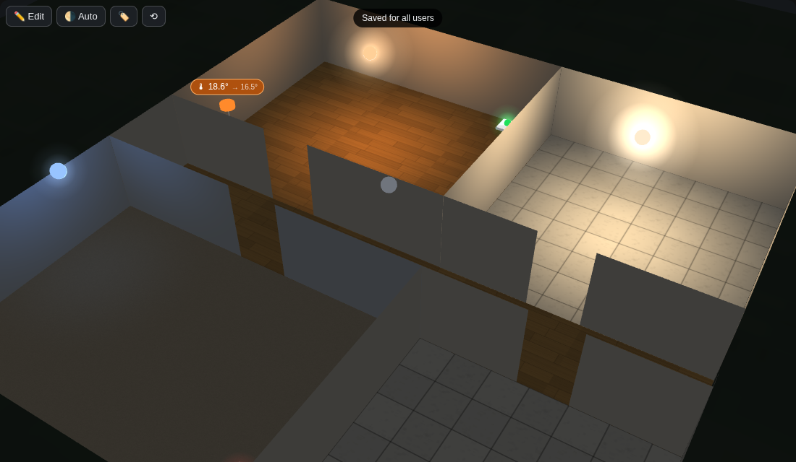
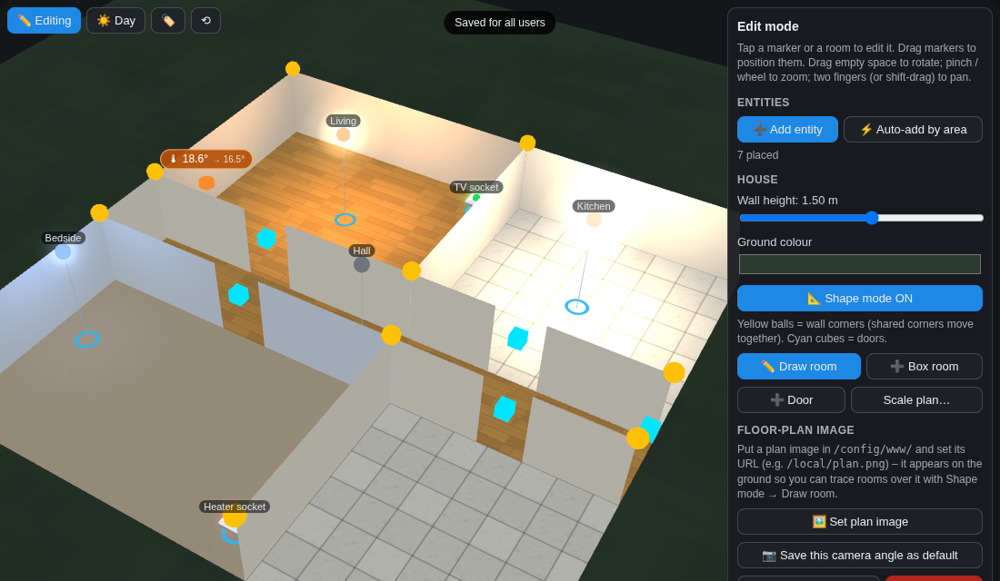
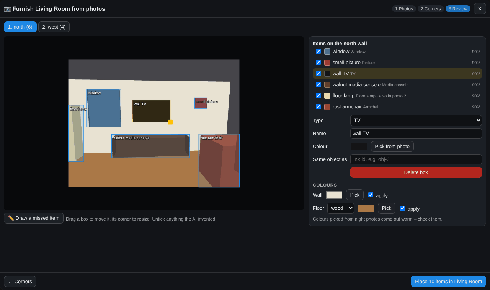
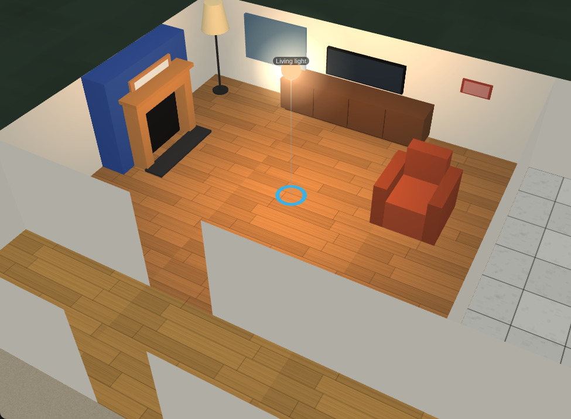

# House 3D Card

[](https://hacs.xyz)
[](https://github.com/markrgriffin/lovelace-house-3d-card/releases)


A rotatable 3D mimic of your house for Home Assistant dashboards. Lights glow in their real colour and brightness, sockets show a red/green LED, thermostats show current → target temperature, and everything is placed by dragging it around the 3D model — no YAML positioning.



📖 **Walkthrough with screenshots and install steps:** [A Rotatable 3D House Dashboard for Home Assistant](https://thehomelabbench.com/home-assistant-3d-house-dashboard/)

## Features

- **Rotate, zoom and pan** by dragging (mouse or touch, pinch to zoom, two fingers to pan). Near walls hide themselves so you can always see in.
- **Lights** light up their own room in the entity's colour, and the pool of light shrinks as the light dims. Light never bleeds through walls.
- **Sockets / switches** show as a wall plate with a green (on) or red (off) LED.
- **Climate** entities show a chip with current → target; it turns orange while heating. Tap for a −/+ target popup and HVAC modes.
- **Tap** a light or socket to toggle it. **Long-press** for the Home Assistant more-info dialog (dimming, colour, history).
- **Day / night**: ambient light follows `sun.sun`, or force day/night from the toolbar.
- **Edit mode** (admins): drag entities into position, set their height and light reach; per-room floor texture (wood, carpet, tile) and colour, wall colour, wall height; move wall corners and doors; draw new rooms.
- **Trace your own floor plan**: show a scanned/drawn plan image on the ground and tap out each room's corners over it.
- **Furniture** (new in 1.1): sofas, tables, lamps, TVs, fireplaces, pictures, windows and more, drawn as simple low-poly shapes, lit by your lights. Add them by hand, or **furnish a room from photos** with Home Assistant's AI Task.
- **Per-wall colours**: give a chimney breast or a feature wall its own colour.
- **Layout saved in Home Assistant**, shared by all users and devices. Export/import as JSON for backup.
- Single file, no CDN, bundles [three.js](https://threejs.org) — works offline and on the companion app.



## Installation

### HACS (recommended)

1. HACS → ⋮ → **Custom repositories** → add `https://github.com/markrgriffin/lovelace-house-3d-card`, category **Dashboard**.
2. Search for **House 3D Card** and download it.
3. HACS registers the resource automatically. If you manage resources yourself, add `/hacsfiles/lovelace-house-3d-card/house-3d-card.js` as a *JavaScript module*.

### Manual

Copy `house-3d-card.js` from the [latest release](https://github.com/markrgriffin/lovelace-house-3d-card/releases) to `/config/www/house-3d-card.js` and add `/local/house-3d-card.js` as a JavaScript module resource.

## Usage

Best in a full-height **panel** view:

```yaml
type: panel
title: House
path: house-3d
cards:
  - type: custom:house-3d-card
```

| Option | Default | Description |
|---|---|---|
| `height` | `calc(100vh - 130px)` | CSS height of the card. |
| `storage_key` | `default` | Which saved layout to use. Use different keys for different cards (e.g. one per floor). |
| `allow_edit` | `true` | Show the Edit button to admins. |
| `ambient` | `auto` | `auto` (follows `sun.sun`), `day`, `night`, or a number 0.05–1. |
| `background` | `#14171a` | Card background colour. |
| `marker_scale` | `1` | Multiply marker size. |
| `plan` | built-in starter house | A full layout object used when nothing has been saved yet (see *Export / import*). |
| `entities` | — | Entity IDs to pre-place when nothing has been saved yet. |
| `ai_task_entity` | preferred | AI Task entity used by *Furnish from photos* (e.g. `ai_task.claude_ai_task`). If unset, the wizard lets you pick one, or uses the one marked preferred in **Settings → AI Task**. |
| `ai_bbox_format` | `pixels` | Set to `gemini` if your AI Task model returns Gemini-style 0–1000 `[ymin, xmin, ymax, xmax]` boxes. |

## Building your house

The card starts with a small generic house. Turn it into yours:

1. **Get a plan image.** A photo of the architect's drawing, a screenshot of a floor-planner, or a sketch — anything. Put it in `/config/www/` (e.g. `/config/www/plan.png`).
2. Tap **✏️ Edit → Set plan image**, enter `/local/plan.png` and roughly how wide the image is in metres. Fine-tune width, offset and rotation with the sliders until it sits where you want it.
3. Tap **Shape mode → Draw room**, then tap each corner of a room in order. Corners snap to existing corners so shared walls line up. Tap the first corner again (or *Finish room*) to close it. Repeat for every room. Delete the starter rooms you don't need (tap a room → Delete room).
4. Add **doors** (+ Door, then drag the cyan cube onto a wall) and set each room's **name, HA areas, floor and wall colour**.
5. Tap **⚡ Auto-add by area** to drop every light and thermostat into the room whose *HA areas* field matches its Home Assistant area, then drag them into their real positions. Add sockets with **➕ Add entity**.
6. **Save.** Untick *Show image outside edit mode* if you don't want the plan visible normally.

Tips: wall height around 1.5 m gives the best view into rooms. The *Scale plan…* button rescales everything at once if you get the metres wrong. *Save this camera angle as default* remembers your favourite view.

## Furniture

In edit mode, tap a room → **➕ Add furniture** and pick from the catalogue. Tap any piece to change its type, name, colour, size, height off the floor and rotation, drag it on the floor to move it, or press **Against nearest wall**. Wall-hung items (TV, pictures, mirrors, windows, radiators) stay on their wall and hide when you look at the wall from behind. Link a lamp to a light entity and its shade glows in the light's colour; tapping it toggles the light.

## Furnish a room from photos



*Administrators only.* Edit mode → tap a room → **📷 Furnish from photos**:

1. **Photos** – tap a wall (or its button) and add a photo of it; repeat for the other walls. **Photo mode** sets the room's lights to neutral white while you take them and puts them back afterwards. Then **Analyse photos**.
2. **Corners** – while the AI works, drag the four handles onto each wall's corners (floor and ceiling). Corners outside the photo? Drag the handle off the picture to where the corner would be. Hidden ceiling? Put the top handles at any height you know and enter it.
3. **Review** – the AI's boxes are drawn on each photo. Untick anything it invented, drag or resize boxes, draw boxes round anything it missed, fix types and colours (or pick colours from the photo). Then **Place**.

Positions come from your corner taps and the room's real size; the AI only recognises things. Items seen in two photos are merged, things standing on other things (a lamp on a side table) sit on top of them, and pictures on a chimney breast come forward with it. Everything lands in edit mode unsaved – drag to fine-tune, then **Save**.



**Requirements and tips**

- Home Assistant **2025.8 or later** with an **AI Task** entity that accepts image attachments (Anthropic, OpenAI, Google Gemini, Ollama with a vision model…). Results depend heavily on the model: use a capable vision model (Claude Sonnet/Opus or similar). Small fast models miss things and invent others.
- Four photos produce a long answer: raise the AI Task's **maximum tokens** to about 8000 (Settings → Devices & services → your AI integration → the AI Task entry → Reconfigure → untick *Recommended*).
- Cost is a few cents to a few tens of cents per room on a large model.
- Take each photo straight on with the **normal 1× camera** – not panorama or 0.5× wide, which bend straight lines. Stand against the opposite wall; daylight or the main lights give the truest colours.
- The card re-encodes photos as JPEG (longest side 1568 px) and uploads them to your local media as `house3d_<room>_<wall><n>.jpg`, replacing earlier ones for the same wall. Delete them from **Media** whenever you like.
- The admin-only restriction is enforced by the card. It stops dashboard users triggering AI calls from it; it is not a server-side permission on the `ai_task` service.

## Export / import

Edit → *Export / import* shows the whole layout as JSON. Keep a copy as a backup, or paste it into the `plan:` option of the card config so a fresh install starts from it.

## Storage

The layout is stored with Home Assistant's frontend system storage (`frontend/set_system_data`, HA 2024.6+), so every user and device sees the same house. On older cores it falls back to per-user storage and the save toast tells you which one was used.

## Browser support

Any browser with WebGL (all current desktop and mobile browsers, and the Home Assistant companion apps). The Home Assistant Cast / Fully-Kiosk on low-end tablets works but rotates less smoothly.

## Development

```
npm ci
npm test           # geometry unit tests (Node)
npm run build      # → dist/house-3d-card.js
python3 test/browser/furnish_test.py   # optional end-to-end test in headless Chromium (needs playwright)
```

`src/house-3d-card.js` is plain ES2020 with no framework; esbuild bundles three.js into the single distributable. `src/furnish-geom.js` holds the photo geometry (homography, camera from four corners, floor back-projection) and is DOM-free; `src/furniture3d.js` draws the furniture; `src/furnish-ui.js` is the wizard. `test/fixtures/make_synthetic.py` renders the synthetic room photos used by the browser test.

## Licence

MIT — see [LICENSE](LICENSE). Bundles three.js (MIT) — see [THIRD-PARTY-NOTICES.md](THIRD-PARTY-NOTICES.md).
